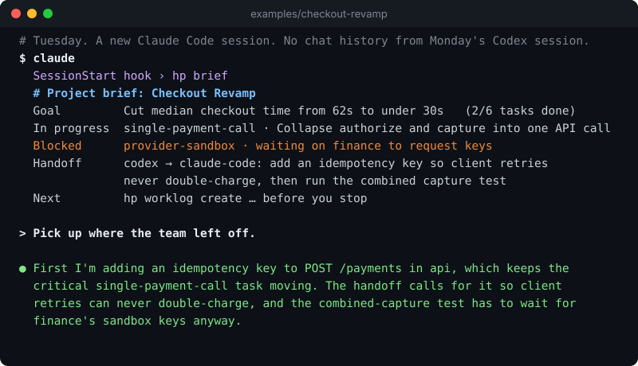

<h1 align="center">Harness Projects</h1>
<p align="center"><strong>Every new agent session starts from zero. Yours don't have to.</strong></p>
<p align="center">Git-backed project memory that Claude Code, Codex, and Cursor read at the start of every session, so any agent picks up exactly where the last one stopped.</p>

<p align="center">
  <a href="https://github.com/chenhg5/harness-projects/releases"></a>
  <a href="https://github.com/chenhg5/harness-projects/actions/workflows/ci.yml"></a>
  <a href="go.mod"></a>
  <a href="LICENSE"></a>
</p>

<p align="center">
  <a href="#quick-start">Quick start</a> ·
  <a href="#try-the-example">Example</a> ·
  <a href="#how-it-works">How it works</a> ·
  <a href="docs/cli.md">CLI guide</a> ·
  <a href="README.zh-CN.md">简体中文</a>
</p>

---

If you work with coding agents on anything longer than one session, you know these:

- **A new session knows nothing.** You re-explain the goal, the decisions, and what is half done, every time.
- **Switching tools loses everything.** What Codex did yesterday is invisible to Claude Code today.
- **Parallel agents and multiple repositories drift.** Nobody holds the plan, so work is repeated or contradicts itself.

Harness Projects keeps the goal, plan, tasks, decisions, and session notes in plain files in their own Git repository. A session-start hook hands every new agent a short **brief**, and a stop hook makes sure it leaves notes for the next one.

<p align="center">
  
</p>
<p align="center"><sub>Condensed from a real run on <a href="examples/checkout-revamp">examples/checkout-revamp</a>. The agent's reply is verbatim; it had no chat history, only the brief.</sub></p>

## Quick start

```bash
curl -fsSL https://raw.githubusercontent.com/chenhg5/harness-projects/main/install.sh | sh
hp project init --path ./my-project --name "My Project"
cd my-project && claude
```

That is all. `hp project init` creates the project as its own Git repository, with instructions for every harness and Claude Code hooks already configured. From now on:

| When | What happens |
| --- | --- |
| A session starts | The agent receives `hp brief`: goal, next actions, in-progress, ready and blocked tasks, the plan, and what the last session left unfinished. The session registers itself; no IDs to copy. |
| The agent works | It updates tasks with `hp task update` and records decisions in `spec/`. |
| The session stops | It runs `hp finish`, which updates the task, writes the work log, and reconciles state together. The stop hook reminds it once if it forgets. |

Tell the agent what you want in plain words ("set the goal: cut checkout time in half, then plan the tasks"); the generated `AGENTS.md` and project skill teach it the commands.

**Codex and Cursor** read the generated `AGENTS.md` and Cursor rule, which start every session with `hp brief`. Codex sessions are detected automatically through `CODEX_THREAD_ID`. After updating `hp`, run `hp project upgrade --path .` in an existing project to refresh managed instructions, hooks, and all supported skill mounts without replacing project-specific instructions. Other install options are in [INSTALL.md](INSTALL.md).

## Try the example

```bash
git clone https://github.com/chenhg5/harness-projects && cd harness-projects/examples/checkout-revamp
hp brief
```

[`examples/checkout-revamp`](examples/checkout-revamp) is a complete project mid-flight: one goal, six tasks across two repositories (done, in progress, ready, blocked), a design decision, a Codex work log, and a Codex → Claude Code handoff. Open it with any agent and ask it to continue.

## How it works

```text
my-project/              # its own Git repository: the shared memory
├── AGENTS.md            # how every agent works here (CLAUDE.md and a Cursor rule point to it)
├── PROJECT.md           # purpose, scope, repositories
├── goals/               # what done looks like
├── state/               # current plan, next actions, health
├── tasks/               # work items with dependencies and status
├── spec/                # decisions and requirements
├── worklogs/            # what each session did and left unfinished
├── handoffs/            # explicit transfers between agents or people
├── context/             # research and reference notes
└── repos/               # your source repositories and worktrees (their own Git history)
```

- **Files, not a service.** Everything is Markdown and JSON that any agent can read and any human can review in a pull request. No server, no account, no lock-in to one tool.
- **One brief, any harness.** `hp brief` works from anywhere inside the project, including nested repository worktrees, and gives the same picture to Claude Code, Codex, Cursor, or a person.
- **Many repositories, one plan.** A feature that touches `web` and `api` has one goal and one task graph; each repository keeps its own branches.
- **Agent-friendly CLI.** Data-producing commands expose JSON, mutations support dry runs, errors are structured, and exit codes are stable, so agents drive it without guessing.
- **Drift is visible.** `hp project doctor` checks whether state, tasks, evidence, work logs, skills, repositories, worktrees, and top-level directories still agree.
- **Folder rules are explicit.** `hp layout list` explains every built-in location. Projects can register intentional additions such as `lib/` with `hp layout add`, while `hp project doctor` flags accidental new top-level directories.

Open a read-only dashboard with `hp project serve --path . --open`.

### Why not just…

| | Keeps progress between sessions | Shared across tools | Reviewed in Git | Spans repositories |
| --- | --- | --- | --- | --- |
| `CLAUDE.md` / `AGENTS.md` alone | Static instructions only | Partly | Yes | No |
| Built-in Projects or memory in one tool | Yes | No | No | No |
| An issue tracker | Yes, if someone copies it in | Not read at session start | No | Yes |
| **Harness Projects** | Yes | Yes | Yes | Yes |

## Advanced: coordinating several agents

When you run several sessions at once, `hp` can also route work between them:

- `hp agent discover` lists registered sessions; `hp task inbox` shows work assigned to the current one.
- A transferable **Coordinator** role can assign tasks and deliver them to an exact existing session with `hp coordinator dispatch`, keeping uncertain deliveries out of automatic retries.
- `hp wakeup` wakes the Coordinator on an interval or cron schedule.

See the [CLI guide](docs/cli.md) for these commands and their safety rules, and the [capability map](docs/capability-map.md) for what is planned (remote runners, event triggers, approvals).

## Learn more

| Read this | For |
| --- | --- |
| [Installation](INSTALL.md) | Release archives, Go installation, and source builds |
| [CLI guide](docs/cli.md) | Every command, hooks, session detection, dispatch, and the dashboard |
| [Product model](docs/product.md) | Project, Goal, Task, Run, Agent, Thread, and Coordinator concepts |
| [Specifications](spec/README.md) and [RFCs](rfcs/README.md) | The portable file contract and design proposals |
| [Changelog](CHANGELOG.md) | What changed in each release |

## Contributing

Issues and pull requests are welcome; see [CONTRIBUTING.md](CONTRIBUTING.md). The CLI follows the [Agent CLI Guide](https://github.com/Johnixr/agent-cli-guide): explicit arguments, structured output, dry runs, and stable exit codes.

## License

Apache License 2.0. See [LICENSE](LICENSE).
