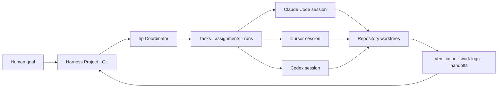

<h1 align="center">Harness Projects</h1>
<p align="center"><strong>One project. Many repositories. Any coding agent.</strong></p>
<p align="center">An open, Git-backed Projects workspace for Claude Code, Cursor, Codex, and other coding harnesses.</p>

<p align="center">
  <a href="https://github.com/chenhg5/harness-projects/releases"></a>
  <a href="https://github.com/chenhg5/harness-projects/actions/workflows/ci.yml"></a>
  <a href="go.mod"></a>
  <a href="LICENSE"></a>
</p>

<p align="center">
  <a href="#quick-start">Quick start</a> ·
  <a href="#how-it-works">How it works</a> ·
  <a href="#what-works-today">Features</a> ·
  <a href="docs/cli.md">CLI guide</a> ·
  <a href="README.zh-CN.md">简体中文</a>
</p>

---

Claude Code Projects and Cursor Projects point toward a richer way to organize long-running agent work. Harness Projects brings that idea into an open workspace: goals, tasks, context, session assignments, work logs, and verification live in files that every harness can read.

`hp` is the Go CLI that creates and maintains that workspace. It can route a task to an **explicit existing session** through a supported provider CLI. When direct delivery cannot begin safely, the assignment stays in that session's inbox.

> **A project can span repositories.** A Harness Project has its own Git history for coordination. Its `repos/` directory can contain several independent source repositories and worktrees. One feature can span all of them.

## Quick start

Install the latest release on macOS or Linux:

```bash
curl -fsSL https://raw.githubusercontent.com/chenhg5/harness-projects/main/install.sh | sh
hp --version
```

The installer downloads a release archive and verifies its SHA-256 checksum. You can also [install with Go or download an archive](INSTALL.md).

Create a project and open its local dashboard:

```bash
hp project init --path ./my-project --name "My Project"
hp project validate --path ./my-project
hp project serve --path ./my-project --open
```

The generated project includes shared instructions, goal and task directories, a project-context skill, and entry points for Codex, Claude Code, and Cursor. The dashboard shows goals, task progress, project state, repositories, and recent activity in English or Simplified Chinese.

## How it works



1. **Define the outcome.** Keep the goal, completion conditions, specifications, and current plan in the project.
2. **Route work.** Create tasks with dependencies, discover registered agent sessions, and assign a task to an exact provider session ID.
3. **Deliver or queue.** `hp coordinator dispatch` uses the provider CLI when preflight allows it. Otherwise the task remains discoverable through `hp task inbox`.
4. **Preserve progress.** Runs capture delivery outcomes and evidence. Work logs explain what happened; handoffs explain what the next agent should do.

### A task across harnesses

```bash
cd my-project

hp task create --project . --id improve-api --title "Improve the API" \
  --description "Reduce request latency" --acceptance "Benchmark and tests pass"

# The target agent records its real provider session; direct delivery has a separate safety check.
SESSION_ID="paste-real-provider-session-id"
hp agent register --project . --harness claude-code \
  --session-id "$SESSION_ID" --worktree . --focus "API latency"

hp coordinator dispatch --project . --task-id improve-api \
  --harness claude-code --session-id "$SESSION_ID" \
  --worktree . --dry-run

# Remove --dry-run when the exact target and worktree are correct.
hp coordinator dispatch --project . --task-id improve-api \
  --harness claude-code --session-id "$SESSION_ID" --worktree .
```

The target session can inspect its assigned work with `hp task inbox --project . --harness claude-code --session-id "$SESSION_ID"`. An active Claude Code session may be queued for inbox discovery instead of resumed by a second process. A provider CLI result does **not** complete the task automatically; acceptance still needs evidence. If a process may have received the prompt but returns no clear result, the run is marked `uncertain` and is never resent automatically.

## What works today

| Capability | Available in `hp` |
| --- | --- |
| Project workspace | Git-backed project initialization, validation, file access, and shared harness entry points |
| Goals and work | Outcome-oriented goals, task dependencies, run records, state snapshots, and verification references |
| Shared context | Searchable memory records, work logs, handoffs, and project-context skills |
| Agent coordination | Durable session participation and discovery, exact-session task inbox, CLI dispatch to Codex, Claude Code, and Cursor |
| Source repositories | Repository registration and local Git worktree lifecycle under `repos/` |
| Visibility | Read-only local dashboard with English and Simplified Chinese UI |
| Maintenance | Dry-run support, structured JSON output, and bounded cleanup of transient material |

Harness Projects is **local-first** today. Remote runners, event triggers, unattended scheduling, and approval workflows are planned; the [capability map](docs/capability-map.md) tracks the boundary between the current CLI and the product target. Provider sessions remain provider-specific: cross-harness continuation uses the shared project files, not a shared hidden chat transcript.

## Project layout

```text
my-project/              # Its own Git repository
├── PROJECT.md           # Purpose and scope
├── AGENTS.md            # Shared agent entry point
├── CLAUDE.md            # Claude Code entry point
├── goals/               # Outcomes and completion conditions
├── spec/                # Requirements and decisions
├── state/               # Current plan and snapshot
├── tasks/               # Dependencies and assignments
├── runs/                # Attempts and evidence
├── agents/sessions/     # Durable session participation
├── context/             # Searchable project memory
├── worklogs/            # What each session did
├── handoffs/            # Continuation instructions
├── verification/        # Acceptance evidence
├── skills/              # Shared skills
├── scripts/             # Shared scripts
├── repos/               # Independent source repos and worktrees
├── .codex/              # Codex skill mounts
├── .claude/             # Claude Code skill mounts
├── .cursor/             # Cursor rules
└── .harness-project/    # Project metadata
```

The coordination repository tracks the project files. Nested source repositories keep their own branches and commit histories; transient artifacts and local delivery hints are ignored by project Git; participant records are tracked.

## Explore the project

| Read this | For |
| --- | --- |
| [Installation](INSTALL.md) | Release archives, Go installation, and source builds |
| [CLI guide](docs/cli.md) | Commands, session discovery, dispatch outcomes, and the dashboard |
| [Product model](docs/product.md) | Project, Goal, Task, Run, Agent, Thread, and Coordinator concepts |
| [Specifications](spec/README.md) and [RFCs](rfcs/README.md) | Portable file contract and design proposals |
| [Capability map](docs/capability-map.md) | Implemented features and longer-term direction |
| [Changelog](CHANGELOG.md) | What changed in each release |

## Contributing

Issues and pull requests are welcome. See [CONTRIBUTING.md](CONTRIBUTING.md) for the development workflow. The CLI follows the [Agent CLI Guide](https://github.com/Johnixr/agent-cli-guide): explicit arguments, structured output, dry runs, and stable exit semantics.

## License

Apache License 2.0. See [LICENSE](LICENSE).
