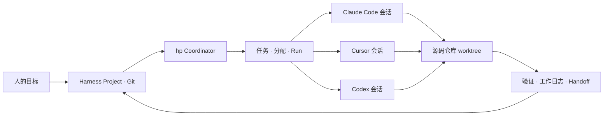

<h1 align="center">Harness Projects</h1>
<p align="center"><strong>一个项目，多个仓库，跨 Coding Agent 协作。</strong></p>
<p align="center">面向 Claude Code、Cursor、Codex 等编程 Harness 的开放式 Projects 工作空间，以 Git 保存可共享的项目上下文。</p>

<p align="center">
  <a href="https://github.com/chenhg5/harness-projects/releases"></a>
  <a href="https://github.com/chenhg5/harness-projects/actions/workflows/ci.yml"></a>
  <a href="go.mod"></a>
  <a href="LICENSE"></a>
</p>

<p align="center">
  <a href="#快速开始">快速开始</a> ·
  <a href="#工作方式">工作方式</a> ·
  <a href="#现有能力">现有能力</a> ·
  <a href="docs/cli.md">CLI 文档</a> ·
  <a href="README.md">English</a>
</p>

---

Claude Code Projects 和 Cursor Projects 展示了长期运行的 Agent 项目该如何组织。Harness Projects 将这类工作方式放进开放的项目目录：目标、任务、上下文、会话分配、工作日志和验证记录都保存在各个 Harness 可读取的文件里。

Go 编写的 `hp` CLI 用来创建和维护这个工作空间。它可以通过对应的 CLI，把任务交给**明确指定的已有会话**。如果直接投递无法安全开始，任务会留在该会话的 inbox 中，供 Agent 自主发现。

> **项目可以跨仓库。** Harness Project 用自己的 Git 仓库追踪协作状态；`repos/` 下可以放多个独立的源码仓库及 worktree。一个需求可以同时涉及它们。

## 快速开始

在 macOS 或 Linux 安装最新版本：

```bash
curl -fsSL https://raw.githubusercontent.com/chenhg5/harness-projects/main/install.sh | sh
hp --version
```

安装脚本会下载发布包并校验 SHA-256。也可以[通过 Go 安装或直接下载发布包](INSTALL.md)。

创建项目并打开本地看板：

```bash
hp project init --path ./my-project --name "My Project"
hp project validate --path ./my-project
hp project serve --path ./my-project --open
```

新项目包含共享说明、目标和任务目录、项目上下文 Skill，以及 Codex、Claude Code、Cursor 各自的入口文件。看板可查看目标、任务进度、项目状态、仓库和最近活动，支持英语与简体中文。

## 工作方式



1. **说明目标。** 在项目中记录目标、完成条件、规范和当前计划。
2. **分配任务。** 创建带依赖关系的任务，发现已注册的 Agent 会话，并把任务关联到准确的 provider session ID。
3. **直接投递或留在 inbox。** 预检通过时，`hp coordinator dispatch` 调用对应 Harness 的 CLI；无法安全启动时，Agent 可通过 `hp task inbox` 找到任务。
4. **沉淀进度。** Run 记录投递结果与证据；工作日志说明本次做了什么；handoff 说明下一个 Agent 如何继续。

### 给已有会话派活

```bash
cd my-project

hp task create --project . --id improve-api --title "Improve the API" \
  --description "Reduce request latency" --acceptance "Benchmark and tests pass"

# 目标 Agent 登记真实的 Provider 会话；直接投递另有安全检查。
SESSION_ID="paste-real-provider-session-id"
hp agent register --project . --harness claude-code \
  --session-id "$SESSION_ID" --worktree . --focus "API latency"

hp coordinator dispatch --project . --task-id improve-api \
  --harness claude-code --session-id "$SESSION_ID" \
  --worktree . --dry-run

# 确认目标会话和工作目录后，去掉 --dry-run 执行。
hp coordinator dispatch --project . --task-id improve-api \
  --harness claude-code --session-id "$SESSION_ID" --worktree .
```

目标会话也可以运行 `hp task inbox --project . --harness claude-code --session-id "$SESSION_ID"` 自行发现任务。Claude Code 会话仍在运行时，CLI 可能把任务留在 inbox，而不另开进程恢复会话。Provider CLI 成功退出**不会自动把任务标记完成**；仍需按验收条件记录证据。如果进程可能已经收到 prompt，但没有明确结果，Run 会标记为 `uncertain`，不会自动重试。

## 现有能力

| 能力 | `hp` 当前支持 |
| --- | --- |
| 项目工作空间 | 独立 Git 项目的创建与校验、文件操作、跨 Harness 入口 |
| 目标与执行 | 有完成条件的目标、任务依赖、Run、状态快照和验证引用 |
| 共享上下文 | 可搜索的记忆、工作日志、handoff 和项目上下文 Skill |
| Agent 协作 | 持久会话参与记录和发现、准确会话的任务 inbox，以及面向 Codex、Claude Code、Cursor 的 CLI 投递 |
| 源码仓库 | 仓库登记和 `repos/` 下的本地 Git worktree 生命周期 |
| 可视化 | 只读本地看板，支持英语和简体中文 |
| 日常维护 | dry-run、结构化 JSON 输出、临时文件清理 |

目前 Harness Projects 以**本地运行**为主。远程 Runner、事件触发、无人值守调度和审批流程仍在规划中；[能力地图](docs/capability-map.md)区分了已经实现的 CLI 能力与产品目标。不同 Harness 的会话仍由各自的 Provider 管理；跨 Harness 接力依靠共享项目文件，而不是某个工具的私有聊天记录。

## 项目目录

```text
my-project/              # 独立的 Git 仓库
├── PROJECT.md           # 项目目的和范围
├── AGENTS.md            # 共享 Agent 入口
├── CLAUDE.md            # Claude Code 入口
├── goals/               # 目标与完成条件
├── spec/                # 需求和决策
├── state/               # 当前计划与状态快照
├── tasks/               # 任务依赖和分配
├── runs/                # 执行尝试与证据
├── agents/sessions/     # 持久会话参与记录
├── context/             # 可搜索的项目记忆
├── worklogs/            # 每次会话的工作记录
├── handoffs/            # 继续工作的说明
├── verification/        # 验收证据
├── skills/              # 共享 Skill
├── scripts/             # 共享脚本
├── repos/               # 独立源码仓库和 worktree
├── .codex/              # Codex Skill 映射
├── .claude/             # Claude Code Skill 映射
├── .cursor/             # Cursor 规则
└── .harness-project/    # 项目元数据
```

项目 Git 仓库追踪协作文件，包括 `agents/sessions/` 中的参与记录。`repos/` 中的源码仓库保留各自的分支和提交历史；临时产物及本机直接投递线索不会提交到项目 Git。

## 继续了解

| 文档 | 内容 |
| --- | --- |
| [安装说明](INSTALL.md) | 发布包、Go 安装、源码构建 |
| [CLI 文档](docs/cli.md) | 命令、会话发现、投递结果和看板 |
| [产品模型](docs/product.md) | Project、Goal、Task、Run、Agent、Thread、Coordinator |
| [规范](spec/README.md)与 [RFC](rfcs/README.md) | 可移植的文件协议与设计提案 |
| [能力地图](docs/capability-map.md) | 已实现能力与长期方向 |
| [更新日志](CHANGELOG.md) | 各版本变化 |

## 参与贡献

欢迎提交 Issue 和 Pull Request。开发流程见 [CONTRIBUTING.md](CONTRIBUTING.md)。CLI 遵循 [Agent CLI Guide](https://github.com/Johnixr/agent-cli-guide)：明确的参数、结构化输出、dry-run 和稳定的退出码语义。

## 许可证

Apache License 2.0，详见 [LICENSE](LICENSE)。
